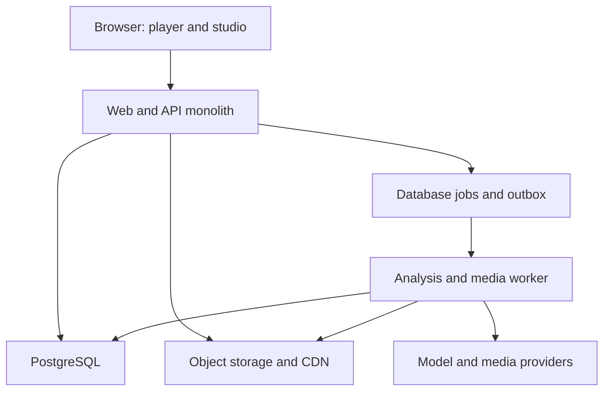

# System architecture
## Approach
Modular monolith plus separate worker. PostgreSQL is authoritative. Browser plays immutable story bundles; expensive analysis and media work run asynchronously.

Alternatives: scene-per-click generation was rejected for latency, consistency and reviewability; microservices are deferred due to operational and transactional overhead. Curated playback plus assisted authoring is the recommended baseline.

## Proposed stack
| Layer | Choice | Boundary |
|---|---|---|
| UI/API entrypoints | React, TypeScript, Next.js stable | Pin supported versions at implementation |
| Scenes | DOM/SVG, CSS/Web Animations | Accessible composition and static fallback |
| Player | XState | Persist domain state; avoid opaque vendor snapshots |
| Author editor | React Flow | Not default reader interface |
| Large graphs | Sigma.js/Graphology if profiling justifies | Optional S4 view |
| Data | Managed PostgreSQL | Relational integrity, JSONB bundles, RLS |
| Queue | PostgreSQL leases and transactional outbox | No broker initially |
| Media | S3-compatible store, CDN | Approved public media only on public CDN |
| Telemetry | OpenTelemetry-compatible | No story text in telemetry |
| Retrieval | PostgreSQL full-text first | Embeddings only after retrieval evaluation |

Select supported stable dependencies and lock exact versions in S1; research default branches are not installation instructions. No Redis, Kubernetes, Neo4j or vector service is required for MVP.

## Modules
catalog owns public discovery; identity/access owns memberships and consent; stories owns drafts/revisions; evidence owns claims and provenance; narrative owns pure transitions; analysis owns provider-independent jobs; media owns assets and rights; progress owns viewer snapshots; audit owns minimal security/editorial events; meaning owns opt-in traditions; billing later owns entitlements.
Each writes its own tables via application services. Cross-module mutations use explicit transactions or outbox events. Browser contracts must not export server secrets or database clients.

## Future repository layout
- apps/web/src/app: gallery, story, studio and API routes.
- apps/web/src/features/player: scene composition and controls.
- apps/web/src/features/studio: authoring UI.
- apps/worker/src: job handlers and provider adapters.
- packages/contracts: versioned schemas and API types.
- packages/domain: narrative rules, graph invariants, policy.
- packages/db: migrations, RLS, repositories.
- packages/content: bundle compiler.
- packages/observability: safe telemetry.
- content/fiction/kamran: reviewed story sources and licensed assets.
- tests: domain, integration, accessibility, contract and evaluation tests.
- infra: deployment definitions and recovery runbooks.

These paths are proposed, not scaffolded.

## Scaling
Scale stateless web replicas first; bound worker concurrency by class and workspace. Publication remains one atomic database transaction. Add a broker only if measured queue contention justifies it. Add a graph database only if bounded relational traversals cannot meet measured needs. Provider outages must not affect published playback.
