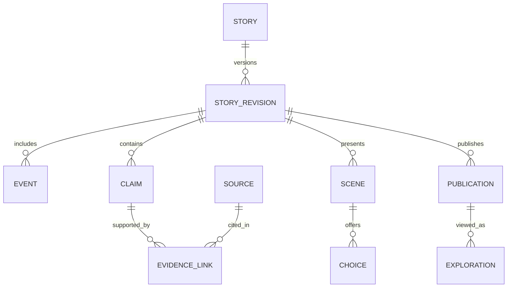

# Domain and data architecture
## Three graphs
1. Event graph: who did what, where and when; temporal and reported relationships.
2. Explanation graph: claims about possible appraisals, emotions, needs and contextual mechanisms.
3. Narrative graph: authored scenes, choices and presentation order.

A flashback in the narrative graph does not reverse historical causality. Explanation loops refer to a recurring pattern across time, not an event causing itself backward in time. The three graphs share IDs by reference but never merge semantics.

## Entity catalog
All mutable workspace-owned rows have id, workspace_id, created_at, updated_at and integer row_version. Public catalog data is an explicit publication projection, not unfiltered workspace data.

| Entity | Key fields and responsibility |
|---|---|
| workspace/member | Tenant and roles; no client-supplied ownership trust |
| subject | Kind fictional/historical/self/consented_private; display identity; consent reference |
| story | Owner, mode, language, publication policy, current published revision |
| story_revision | Immutable revision ID, schema version, parent, checksum, review status |
| event | Subject participants, interval, date precision, context, observable action |
| claim | Kind, text key, subject, event, scope, basis, status |
| source | Origin, author, locator, retrieved time, rights, availability |
| evidence_link | Claim/source span, supports/contradicts/context_only, reviewer |
| relation | Typed endpoints, direction, temporal scope, linked explanatory claim |
| perspective | Participant, event, report/interpretation IDs; never omniscient default |
| scene | Ordered cues, hotspots, asset references, relation references |
| choice/outcome | Conditions, allowed next scenes, hypothetical consequences |
| asset | Storage key, content hash, rights, character variant, alt text, review |
| analysis_run | Input revision, prompt/model/config version, status, cost, candidate output |
| review | Reviewer identity, decision, reasons, target revision and claim |
| publication | Approved immutable bundle, asset manifest, active/revoked |
| exploration | Private viewer state, bundle revision, branch history |
| consent_record | Subject, scope, purpose, grant/revocation times |
| deletion_request | Scope, progress, external-provider status, completed timestamp |
| audit_event | Actor/action/object ID, request ID; no sensitive full text |
| job/outbox | Durable asynchronous intent and delivery status |

## Claim kinds
observed_event: directly recorded external event, not inferred inner state.
participant_report: attributed statement, not automatic truth.
authored_fiction: invented interior content in an explicitly fictional story.
hypothesis: possible explanation.
scenario: conditional alternative.
meaning_interpretation: attributed philosophical/religious interpretation.

Publication quality status (draft, reviewed, disputed, retracted) is orthogonal to kind. Review never turns a hypothesis into observed_event. Claim support: none, contextual, direct, conflicting; these are evidence descriptions, not statistical confidence.

## Relation vocabulary
precedes, reported_by, interpreted_as, may_contribute_to, evokes_in_fiction, response_to, reinforces_pattern, contradicts, protective_context, constrained_by, alternative_to, affects.
Each edge records origin (author/source/model), review status, claim ID and time scope. Causal phrasing requires reviewed evidence appropriate to that claim. Generic theory links remain contextual.

## Relational integrity
Use UUID identifiers and composite tenant foreign keys (workspace_id, id). All relation endpoints belong to the same authorized workspace and story revision unless an explicit approved public reference is used. For normalized polymorphic nodes, maintain graph_node(workspace_id, revision_id, id, node_type) and reference that table rather than unenforced JSON IDs.
Indexes: events(story_id, interval_start), claims(story_id, kind, status), relations(revision_id, source_id), relations(revision_id, target_id), evidence_link(claim_id), publications(story_id, active), jobs(status, run_after).
JSONB holds bounded scene payloads and compiled bundles; normalized claims/evidence remain queryable.
Deletion of a cited source invalidates dependent claims and publications according to review policy rather than silently cascading away provenance.

## Time and versions
Store event start/end with precision day/month/year/approximate/unknown and optional original calendar text. Never fabricate exact timestamps for historical uncertainty.
Story revision is immutable after review begins. Draft edits create a new draft revision or increment draft row_version. Publishing uses optimistic concurrency, review of exact content hash and atomic publication pointer update.
Scene/claim IDs remain stable only when identity is unchanged; edits create new version records. Existing explorations pin their bundle version; explicit migration maps compatible scene IDs or asks viewer to restart.
Source retraction triggers dependency traversal → affected claims marked stale → publication review flag or immediate revocation for severe errors. Reanalysis never overwrites old reviewed content.

## ER overview

## Optional retrieval
Start with per-workspace full-text search. If embeddings are introduced, derived rows inherit source ownership, revision and deletion status. Retrieval filters run before ranking and before model context assembly. Vector similarity is not evidence of psychological truth.

## Public cross-story references
An external reference is exactly {publicationId, publicationRevision, exportedNodeId}. It resolves only against a sanitized approved publication export, verifies active status, and never traverses into the source workspace's raw claims, notes or evidence tables. A revoked or unavailable publication renders an unavailable-reference placeholder. No cross-workspace raw foreign key is permitted through this exception. Include nested reference authorization and revocation in G06 tests.
