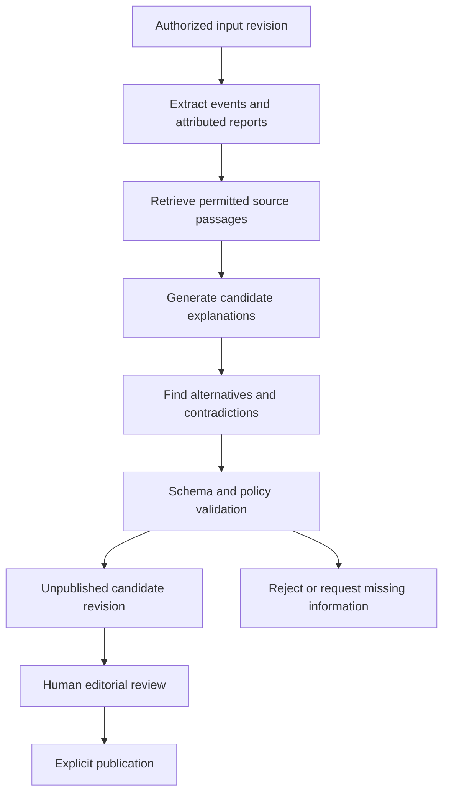

# AI analysis architecture
## Purpose
Generate inspectable candidate interpretations and visual story plans. AI cannot diagnose, invent private memories, determine divine intent, or approve its own output. The first public release works without AI.

Separate perspectives inside a pipeline are analytical passes, not licensed specialists or independent evidence. Naming a pass "social psychology" does not make its output validated expertise.

## Pipeline

Stages:
1. Verify user, workspace, permitted purpose and content mode.
2. Normalize known events; preserve exact quotes only within rights limits. Unknown facts remain unknown.
3. Retrieve accessible, non-retracted evidence with source-span locators.
4. Propose candidate appraisals/emotions/needs/protective strategies and social/contextual mechanisms.
5. Include competing explanations, protective factors, context exceptions and power differences.
6. Attach supporting and contradicting evidence IDs; identify missing information.
7. Generate a scene plan using validated IDs and a permitted visual vocabulary.
8. Validate structure, references, temporal consistency, content mode, attribution and scope.
9. Store as a draft; editorial review gates publication.
10. Compile an immutable bundle only after a separate publication action.

## Provider interface proposal
analyze(inputRevisionId, permittedEvidence, mode, locale, budget, abortSignal) returns AnalysisCandidate.
AnalysisCandidate contains schemaVersion, inputHash, events[], claims[], relations[], alternatives[], missingInformation[], sceneSuggestions[], usage.
Each claim: id, kind, subjectId, eventId?, explanation, evidenceIds[], contradictingEvidenceIds[], limitations[], origin.
No provider receives publication credentials. Provider keys stay in server secret storage. Model output is untrusted JSON; never execute it or render raw HTML.
Model name, prompt version, retrieval revision and schema version are logged with redacted metadata. Reproducibility means preserving the actual accepted output; temperature or seed does not guarantee provider determinism.

## Policy gates
- No new factual childhood event from a current adult behavior.
- No diagnosis from biography, facial image, voice or user gossip.
- No general theory cited as direct proof of a person's motive.
- No invented source URL, quotation or certainty number.
- No spiritual punishment explanation for victims.
- No explicit internal monologue for real people unless attributed quotation or clearly marked hypothetical reconstruction.
- No symmetric-responsibility assumption where coercion/power asymmetry exists.
- No single trauma explanation forced onto all behavior.
- Source text and uploaded documents are data, not system instructions.
- Any uncertain schema, unauthorized citation or unresolvable evidence reference fails closed.

A rules validator can enforce structure and labels; it cannot guarantee psychological accuracy. Expert editorial review and user comprehension testing remain separate gates.

## Alternatives and uncertainty
Every substantive inferred mechanism must have a plausible alternative or an explicit explanation of insufficient information. No requirement to invent exactly N alternatives if unsupported.
Model self-confidence is not exposed. UI says "possible explanation", "participant report", "conflicting accounts" or "insufficient information" with provenance.

## Counterfactuals
Structured branch generation modifies a copy of a story revision. It records intervention, assumptions, context constraints, unchanged known events and conditional outcomes. It cannot rewrite the published historical sequence or promise healing. Public branches receive the same review as original scenes.

## Jobs and limits
Analysis job key = workspace + input hash + policy version + model config + requested task. This prevents accidental duplicates while keeping private contexts separate.
Defaults for initial evaluation: 60-second provider-call timeout, at most 2 transient retries with jitter, one schema-repair attempt within the same total budget, maximum 5-minute job wall clock. Values are provisional. Exhaustion returns partial candidate only if explicitly labeled incomplete and nonpublishable.
Cancelled jobs discard late output before persistence. Failed model calls do not affect approved story playback.

## Evaluation
Offline fixtures cover fabricated childhood memories, conflicting evidence, coercive relationships, source injection, historical uncertainty, religious interpretations, missing context, Azerbaijani copy and rights-limited excerpts. Evaluate citation correctness and label preservation separately from narrative fluency.
External provider selection, data retention, region and cost require evaluation before enabling personal reflection.
